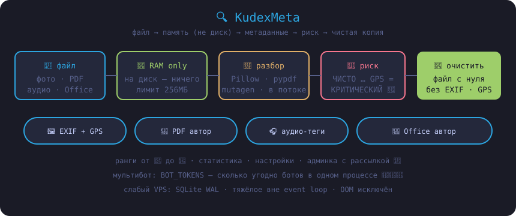

# 🔍 KudexMeta


Telegram-бот, который показывает **все скрытые метаданные** твоих файлов — и стирает их одной кнопкой.

> Каждое фото рассказывает о тебе больше, чем ты думаешь: где снято, на что, когда и чем обработано.



## ✨ Возможности

| Функция | Описание |
|---|---|
| 🖼 **Изображения** | Полный EXIF: камера, объектив, ISO/диафрагма/выдержка, дата съёмки, GPS с ссылкой на карту |
| 📕 **PDF** | Автор, продюсер, программа создания, даты |
| 🎧 **Аудио** | MP3/FLAC/OGG/M4A — теги, исполнитель, кодировщик |
| 📘 **Office** | DOCX/XLSX/PPTX — автор, последний редактор, организация |
| 🚦 **Индикатор риска** | Шкала от «ЧИСТО» до «КРИТИЧЕСКИЙ», если внутри GPS |
| 🧹 **Очистка** | Изображения, PDF и аудио-теги — чистая копия без метаданных |
| 📊 **Статистика** | Личная: сканирования, очищенные файлы, ранги от 🐣 до 👻 |
| ⚙️ **Настройки** | Отправка чистого файла документом или фото |

### 🛠 Админка (`/admin`)

- **📢 Рассылка** в 3 шага: любой контент (текст с HTML, фото, видео, аудио, файлы) → inline-кнопки → подтверждение. Прогресс-бар в реальном времени, обход флуд-лимитов Telegram, отчёт о доставке.
- **📊 Статистика бота**: пользователи, активность, аптайм
- **👥 Топ юзеров** и новички
- **🚫 Бан-лист**: бан/разбан по ID

Доступ по нику из переменной окружения `ADMIN_USERNAMES` — бот сам выдаёт права при первом `/start`.

## 🚀 Запуск

### Docker (рекомендуется)

```bash
git clone https://github.com/sudxxt-afk/KudexMetadata.git
cd KudexMetadata

cp .env.example .env   # впиши токен и свой ник
docker compose up -d --build
```

### Без Docker

```bash
pip install -r requirements.txt
export BOT_TOKEN="123:ABC"
python main.py
```

### 🤖 Несколько ботов на одном сервере

Один процесс умеет держать **сколько угодно ботов** — все токены через `BOT_TOKENS`:

```env
BOT_TOKENS=111111:AAA..., 222222:BBB..., 333333:CCC...
```

Каждый бот получает свой `Dispatcher` (изолированные FSM-состояния) и живёт в общем event loop: один Python-процесс ≈ одна копия интерпретатора и библиотек в памяти, вместо отдельного контейнера на каждый бот. Идеально для слабого VPS.

- База у ботов общая; статистика админа (`/admin → 📊`) суммарная по всем инстансам.
- Логи помечены юзернеймом каждого бота.
- Палить один токен можно по-старому через `BOT_TOKEN` — оба способа работают одновременно.

## 🔧 Переменные окружения

| Переменная | Обязательна | Описание |
|---|---|---|
| `BOT_TOKEN` | ✅* | Токен от [@BotFather](https://t.me/BotFather) (*если не задан `BOT_TOKENS`) |
| `BOT_TOKENS` | — | Несколько токенов через запятую или перенос строки — мультибот в одном процессе |
| `ADMIN_USERNAMES` | — | Ники админов через запятую (без `@`) |
| `ADMIN_IDS` | — | Числовые ID админов через запятую (альтернатива) |
| `DB_DIR` | — | Папка для SQLite-базы (в Docker: `/app/data`) |
| `PENDING_MAX_FILES` | — | Максимум файлов в кэше памяти (по умолчанию 200) |
| `PENDING_MAX_MB` | — | Жёсткий лимит памяти кэша в МБ (по умолчанию 256) |

## 🧠 Как это работает

1. Бот скачивает файл во **внутреннюю память** (на диск ничего не пишется)
2. `Pillow` / `pypdf` / `mutagen` вытаскивают метаданные — в отдельном потоке, не блокируя event loop
3. Кнопка «Очистить» пересобирает файл с нуля — без EXIF, GPS и истории
4. Оригинал стирается из памяти сразу после отправки

### ⚡ Оптимизации под слабый сервер

- Один процесс — несколько ботов (см. `BOT_TOKENS`)
- SQLite: постоянное подключение, WAL-журнал, индексы — ноль лишних открытий файла БД на каждый запрос
- Очистка изображений перекодировкой без EXIF вместо попиксельного копирования: в разы быстрее и на порядки меньше расход RAM
- Вся тяжёлая обработка (декод картинок, PDF, аудио) — вне event loop
- Кэш скачанных файлов ограничен и по количеству (`PENDING_MAX_FILES`), и по суммарному размеру (`PENDING_MAX_MB`) — OOM исключён

## 📦 Стек


- **aiogram 3** — асинхронный фреймворк Telegram Bot API
- **Pillow + pillow-heif** — EXIF и HEIC-поддержка
- **pypdf** — метаданные PDF
- **mutagen** — аудио-теги
- **SQLite** — статистика и настройки пользователей

## 📄 Лицензия

MIT
